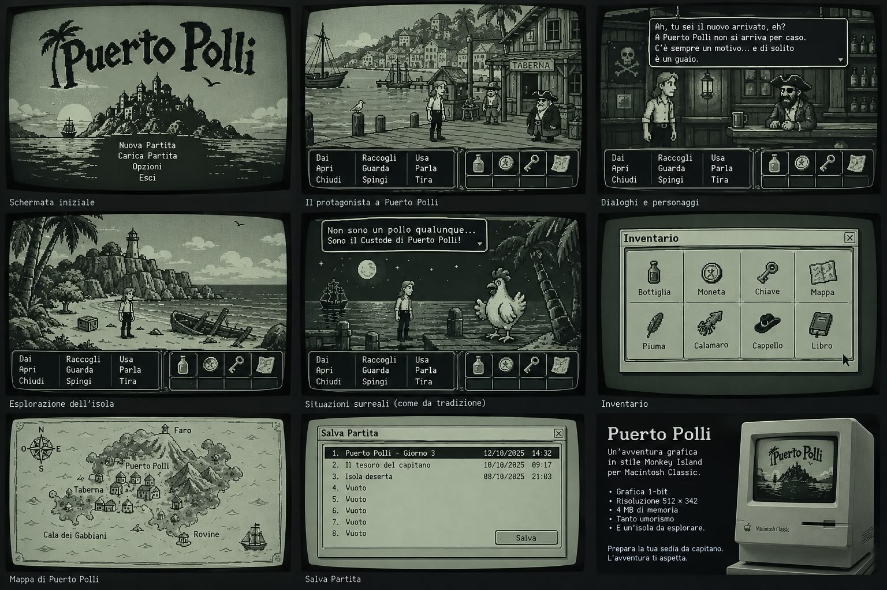

# Puerto Polli

*Un'avventura grafica in stile Monkey Island per Macintosh Classic.*

Grafica 1-bit, risoluzione 512 × 342, interfaccia a nove verbi, inventario,
dialoghi a scelta multipla, mappa dell'isola, salvataggi e tanto umorismo.
La grafica nasce dai mockup in [`reference/mockup.png`](reference/mockup.png):
le scene vengono ritagliate, ripulite e convertite in 1-bit con il
dithering di Atkinson (quello di MacPaint).



## La storia

Sei appena sbarcato a Puerto Polli, l'isola dove chiunque può diventare
pirata... basta ottenere la benedizione del **Custode di Puerto Polli**,
che non è un pollo qualunque. Esplora il molo, la Taberna, la Cala dei
Gabbiani e le Rovine, parla con l'oste Bartolo, con Capitan Barbapollo e con
il Mozzo Pino, e supera le tre prove del Custode.

## Come si gioca

| Azione | Come |
| --- | --- |
| Camminare | clic sulla scena |
| Azione | clic su un verbo (Dai, Apri, Chiudi, Raccogli, Guarda, Spingi, Usa, Parla, Tira) e poi sull'oggetto |
| Usa X con Y / Dai X a Y | verbo, poi oggetto dell'inventario, poi bersaglio |
| Viaggiare | clic sulla **Mappa** nell'inventario, oppure sul sentiero ai bordi delle scene |
| Far avanzare i dialoghi | clic, Spazio o Invio |
| Menu (salva, carica, opzioni, inventario) | pulsante **Menu** o Esc |
| Inventario a finestra | Tab o I |
| Scorciatoie | ⌘S salva, ⌘L carica, ⌘Q esci (Ctrl sul PC) |

Senza verbo selezionato, il clic su un oggetto dell'inventario lo esamina
(e sulla mappa la apre).

<details>
<summary>Soluzione completa (spoiler!)</summary>

1. Taberna: **Dai** la moneta all'oste → bottiglia di grog.
2. Cala dei Gabbiani: **Tira** il cappello incastrato nel relitto.
3. **Usa** il cappello: te lo metti in testa (ora Barbapollo ti parla).
4. Molo: **Dai** la bottiglia a Capitan Barbapollo → chiave.
5. Cala dei Gabbiani: **Apri** la cassa (o Usa chiave con cassa) → calamaro e libro.
6. Molo: **Dai** il calamaro al gabbiano, poi **Raccogli** la piuma.
7. Rovine: parla col Custode («Voglio diventare un pirata»), mostragli il
   cappello e **Dai** piuma e libro.
</details>

## Giocare subito

La cartella [`dist/`](dist) contiene il gioco già compilato:

- `dist/PuertoPolli.dsk` — dischetto da 800K da aprire con Mini vMac o
  Basilisk II (o da scrivere su un floppy vero);
- `dist/PuertoPolli.bin` — l'applicazione in MacBinary, da trasferire su un
  Mac reale e decodificare con StuffIt Expander o BinHex.

Il binario 68k è stato provato in [Executor 2000](https://github.com/autc04/executor)
a 512 × 342 in bianco e nero: titolo, camminata, dialoghi, menu e
salvataggio su disco funzionano.

## Requisiti del Macintosh

- Mac Plus, SE, Classic, Classic II, LC... (68000 o superiore)
- System 6.0.x o System 7.x
- 1 MB di memoria libera (minimo 768 KB)
- Schermo 512 × 342 o più grande: su 512 × 342 il gioco nasconde la barra dei
  menu e usa tutto lo schermo; su schermi più grandi la finestra è centrata.

I salvataggi (8 posizioni) sono file `Puerto Polli Salvataggio N` nella
cartella del gioco.

## Compilare per Macintosh

Serve il toolchain [Retro68](https://github.com/autc04/Retro68) (GCC per 68k
con le Multiversal Interfaces):

```sh
# una volta sola: compila Retro68 (circa mezz'ora)
git clone --recursive https://github.com/autc04/Retro68.git
mkdir Retro68-build && cd Retro68-build
../Retro68/build-toolchain.bash --no-ppc --no-carbon

# poi, nella cartella di Puerto Polli
mkdir build-mac && cd build-mac
cmake .. -DCMAKE_TOOLCHAIN_FILE=/percorso/Retro68-build/toolchain/m68k-apple-macos/cmake/retro68.toolchain.cmake
make
```

Risultati:

- `PuertoPolli.dsk` — immagine di un dischetto da 800K con l'applicazione,
  pronta per un emulatore (Mini vMac, Basilisk II) o per un floppy vero;
- `PuertoPolli.bin` — l'applicazione in formato MacBinary;
- `PuertoPolli.APPL` (+ `.rsrc/`) — data e resource fork separati.

## Compilare per PC (sviluppo e test)

La stessa logica e la stessa grafica girano su PC con SDL2, ingrandite 2×:

```sh
mkdir build && cd build
cmake .. && make
./puertopolli            # il gioco
ctest                    # test automatico: gioca tutta l'avventura
```

Il test (`src/test/main_test.c`) completa l'avventura simulando i clic,
verifica ogni passaggio della soluzione e salva/carica una partita; può anche
salvare schermate in formato PBM.

## Struttura del codice

| File | Contenuto |
| --- | --- |
| `src/engine.c` | motore: camminata, verbi, inventario, messaggi, dialoghi, mappa, finestre, salvataggi, rendering incrementale |
| `src/script.c` | la storia: stanze, oggetti cliccabili, testi, enigmi, dialoghi |
| `src/gfx.c` | grafica 1-bit su framebuffer in formato BitMap QuickDraw (512×342, 64 byte per riga) |
| `src/assets.c` | **generato**: sfondi compressi PackBits, icone, sprite, font |
| `src/mac/main_mac.c` | Toolbox Macintosh: finestra, eventi, CopyBits, File Manager |
| `src/sdl/main_sdl.c` | versione PC con SDL2 |
| `src/test/main_test.c` | test automatico della soluzione |
| `tools/make_assets.py` | pipeline grafica: mockup → scene ripulite → dithering di Atkinson → C |
| `tools/hero.py` | sprite del protagonista (16 fotogrammi, con e senza cappello) |

Il motore è C portabile e non chiama mai il Toolbox: disegna in un
framebuffer che sul Mac viene copiato a video con un solo `CopyBits`.
Per restare veloce su un 68000 a 8 MHz ridisegna ogni fotogramma solo le zone
cambiate (protagonista, box dei dialoghi, pannello).

### Rigenerare la grafica

```sh
pip install pillow numpy opencv-python-headless
python3 tools/make_assets.py      # riscrive src/assets.c e src/assets.h
```

Le anteprime finiscono in `build/preview/`. Il font è DejaVu Sans Mono 11
(senza antialias), per cui serve il pacchetto `fonts-dejavu`.
